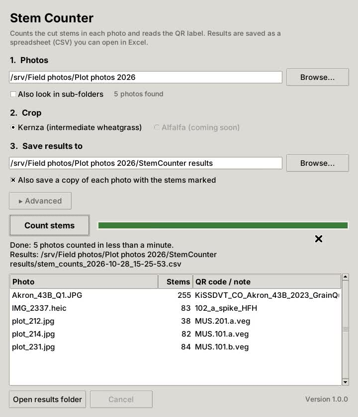

# Stem Counter

**Count the cut stems in photos of Kernza™ (intermediate wheatgrass) bundles, and read each
plot's QR label, without writing any code.**

Point Stem Counter at a folder of photos and click **Count stems**. It saves a spreadsheet
with one row per photo: the number of stems and the plot ID from the QR code on the bag.

<p align="center"></p>

---

## Download

Go to the [**latest release**](https://github.com/Mandar97/StemCounter_v1/releases/latest)
and download the file for your computer:

| Computer | File |
|---|---|
| Windows 10 or 11 (64-bit) | `StemCounter-<version>-Windows.zip` |
| Mac with Apple silicon (M1 or newer), macOS 14 Sonoma or newer | `StemCounter-<version>-macOS.zip` |
| Linux (64-bit, recent distribution) | `StemCounter-<version>-Linux.tar.gz` |

To check a Mac: Apple menu → **About This Mac**. "Chip: Apple M…" means Apple silicon.

### Opening it the first time

The app is not sold through an app store, so your computer will warn you the first time.
You only have to do this once.

**Windows**

1. Right-click the zip → **Extract All…** (the app does not work from inside the zip).
2. Double-click `StemCounter.exe`.
3. If a blue "Windows protected your PC" box appears, click **More info**, then **Run anyway**.

If Chrome or Edge blocks the download, open the downloads list (Ctrl+J) and choose
**Keep** → **Keep anyway**. The app does not connect to the internet.

**Mac**

1. Download the zip **on the Mac itself** and double-click it to unzip. (Copying the app
   through Windows, a USB stick or a shared drive can break it.)
2. Drag `StemCounter.app` into **Applications** and double-click it.
3. When macOS says it cannot verify the app, click **Done**, then go to
   **System Settings → Privacy & Security**, scroll down and click **Open Anyway**.

---

## How to use it

1. **Photos**: choose the folder that holds your photos. Tick *Also look in sub-folders* if
   they are spread across several folders. JPG, PNG, TIFF and iPhone HEIC photos all work.
2. **Crop**: choose *Kernza*.
3. **Save results to**: leave it as it is, or choose another folder.
4. Click **Count stems**.

Shortcut on Windows: drag a folder of photos onto `StemCounter.exe`.

A photo takes a few seconds on a laptop. Everything runs on your own computer; no photos
are uploaded anywhere.

### What you get

A folder called `StemCounter results` inside your photos folder, containing:

- **`stem_counts_<date>_<time>.csv`** — one row per photo; opens in Excel.

  | column | meaning |
  |---|---|
  | `image_name` | the photo (with its sub-folder, if any) |
  | `predicted_count` | the number of stems |
  | `qr_code` | the text of the QR label, or `N/A` if none was found |
  | `notes` | empty, or the reason a photo could not be counted |
  | `crop`, `confidence_threshold` | the settings used, so every number can be traced |

- **`run_info_<date>_<time>.txt`** — the app version, the settings, and a fingerprint of the model.
- **`marked_photos/`** (if you ticked the box) — each photo with every counted stem boxed,
  for checking by eye.

Each run creates new files, so earlier results are never overwritten.

---

## Getting the best counts

The counts are most accurate when:

- the bundle is photographed **end-on**, with the cut stem ends facing the camera;
- the photo is **in focus**, with the stems filling a good part of the frame;
- there is **one bundle** per photo;
- the **QR label** is in the frame, flat and in focus, if you want the plot ID read.

Blurred photos, bundles split into two, and stems cut at an angle (seen from the side
rather than end-on) cause most of the remaining errors.

### How accurate is it?

On 50 Kernza test photos that were never used in training or tuning (3 to 391 stems each,
6,748 stems in total), the app's counts agreed with careful human annotation with a
concordance of 0.998 and an average count error of 2.9%.

---

## Command line (optional)

The same app runs without the window, for scripting:

```
StemCounter --input "D:/Field photos/2026" --crop kernza --save-marked --recursive
StemCounter --help
```

---

## Questions and problems

Please [open an issue](https://github.com/Mandar97/StemCounter_v1/issues). It helps to
include the `run_info_…txt` file from your results folder.

## Citation

A manuscript describing the method is in preparation. Until then, please cite this
repository. The full code, the trained model and step-by-step tutorials will be released
with the paper.
